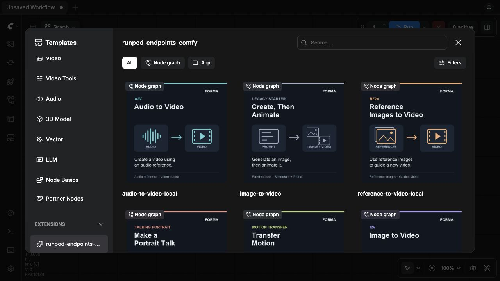
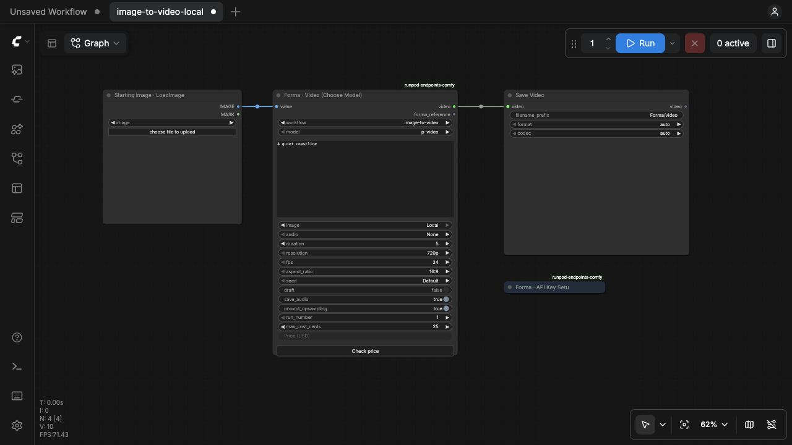

# RunPod Endpoints for ComfyUI

[](https://www.buymeacoffee.com/vavo) [](https://github.com/sponsors/vavo) [](https://www.patreon.com/vavo)

Custom nodes for [ComfyUI](https://github.com/comfyanonymous/ComfyUI) that run cloud image and video generation through [Forma](https://forma.cam), using your Forma API key and prepaid account balance. Inference runs remotely, so these nodes need no local model weights or inference GPU. Choose a workflow and model in the image or video node, or open a ready-wired example for any supported mode.

## Quick install

From your ComfyUI directory, using the Python interpreter that runs ComfyUI:

```sh
git clone https://github.com/vavo/runpod-endpoints-comfy.git custom_nodes/runpod-endpoints-comfy
python -m pip install -r custom_nodes/runpod-endpoints-comfy/requirements.txt
```

1. Restart ComfyUI and refresh the browser. If previews still show gradients, hard-refresh the page to clear cached missing-image responses.
2. At [forma.cam](https://forma.cam), open **Account settings → API keys → Create API key** and add funds to your account.
3. Open **ComfyUI Settings → Forma → API key**, paste your key, and click **Save and test key**. This checks your balance without spending credits.
4. Click **Templates → runpod-endpoints-comfy** under **Extensions**, then choose a workflow. All ten modes are included, plus the image-generation-to-video starters. Choose a model, edit the prompt, and click **Check price** before queueing. No JSON copying is needed.

Requires Python 3.10+, current ComfyUI with native V3 `DynamicCombo`, `VIDEO` and `SaveVideo` support, and outbound HTTPS access to Forma. Keys are saved on the ComfyUI server, outside workflow JSON and browser storage.

## Open a template

After installing or updating the nodes, restart ComfyUI and refresh the browser. Open **Templates → Extensions → runpod-endpoints-comfy** and click a card to load a new workflow. The standalone **text-to-image** and **text-to-video** templates need no input files; media-based templates include connected loaders. **choose-model-image-to-video** generates an image and then animates it.

Templates ship with the node package and update with it. Save your edited workflow normally to keep your own copy. The [workflow list](workflows/README.md) also provides direct JSON downloads. Each preview shows the mode, required inputs, output and a short description. Open the workflow’s **Instructions** node for its usage notes and API-key setup. ComfyUI currently uses filenames as custom-template captions, so the readable descriptions are included in the preview itself.



The menu contains **12 canvas templates**: one for each of the ten modes below, the **choose-model-image-to-video** chain, and the legacy **image-to-video** chain. API-format graphs are in [`workflows/api/`](workflows/api/) for programmatic use.

| Mode | Template | Input files |
| --- | --- | --- |
| T2I | `text-to-image` | None |
| T2V | `text-to-video` | None |
| I2I | `image-to-image-local` | Image |
| I2V | `image-to-video-local` | Image |
| FLF2V | `first-last-frame-to-video-local` | First and last images |
| RF2V | `reference-to-video-local` | Reference image(s) |
| V2V | `video-to-video-local` | Video |
| A2V | `audio-to-video-local` | Audio |
| Talking portrait | `talking-portrait-local` | Image and audio |
| Motion transfer | `motion-transfer-local` | Image and video |

### Choosing a model

1. Open a template, or add **Forma · Image (Choose Model)** / **Forma · Video (Choose Model)** from the Forma category.
2. Select **workflow**, then **model**. Only compatible models appear; changing either rebuilds the controls, so review the new settings and connections.
3. For media inputs, select **Local** to connect a native `IMAGE`, `VIDEO`, or `AUDIO`, or **Reference** to paste an owned `asset:UUID` / public HTTPS URL. Optional inputs also offer **None**. Reference lists take one value per line; local image batches supply multiple references up to the model's limit. To reuse generated media, connect a node's `forma_reference` STRING output to the next node's Reference value input.
4. Set prompts and model controls, then click **Check price**. The node shows the current Forma quote in USD and whether it fits **max_cost_cents**. Checking never starts inference or changes your cap. Click **Run** only when you accept the price; execution gets a fresh quote before purchasing.

FLF2V has its own selector entry and requires both starting and ending frames. RF2V uses `reference-to-video`. Audio-to-video, talking portraits and motion transfer have their required conditioning inputs. LoRA lists use a JSON field with `path` and `scale` entries. Safety follows the Forma account preference; it is not overridden by workflow controls.

Local media is uploaded to your Forma account before quoting. Uploads require a funded account, consume library storage, and follow its retention policy. Each file is limited to 128 MB (your proxy may impose a smaller limit); images are limited to 40 megapixels. Repeating identical bytes with the same run number reuses the owned upload. Keep run numbers unchanged when recovering a request. Expired/removed references stop with an error; intentionally replacing them requires a new run number.

### Start with your own image

Choose **image-to-video-local** in Templates for `Load Image → Forma Video → Save Video`. Click **choose file to upload** in Load Image, select a model, enter your motion prompt and click **Check price**. This workflow has no image-generation branch.

The [workflow list](workflows/README.md) also includes ready-wired local I2I, first/last-frame, reference-video, talking-portrait and motion-transfer examples. Every required image has a Load Image node; audio/video conditioning has the matching loader. Choose your files before checking a price or running.



Screenshots captured from the current package in a clean local ComfyUI instance on 19 October 2026. The canvas shows the default setup before uploading an image or running inference.

### Check price

Both **Choose Model** nodes have a **Check price** button and a **Price (USD)** field. This requests a server quote without queuing ComfyUI or purchasing inference. Editing inputs or letting the quote expire marks the displayed price stale. Your `max_cost_cents` remains a separate spending limit.

Price checks accept direct **Load Image**, **Load Video** (MP4), and **Load Audio** (WAV/MP3/FLAC) connections, or literal **Reference** values. Local files are uploaded to Forma first and use library storage; the account must be funded. They are read only from ComfyUI's input directory. Price checking never executes upstream nodes: a generated or processed reference must already exist and be supplied as an asset/HTTPS reference, or saved and selected in a Load node. The generated-image-to-video starter remains available for chained inference.

The model-selecting nodes output native `IMAGE`/`VIDEO` plus a `forma_reference` string. Built-in Save nodes write results to ComfyUI’s output directory.

## Models and workflows

The bundled catalog contains **39 usable image/video models**: 17 image and 22 video models. The tables below match the selectors in this package. Availability and prices are checked by Forma when you request a quote.

The five speech/text entries are documented separately below and remain disabled because Forma’s account-balance billing is not implemented for them. T2A means text to audio/speech; T2T means text to text.

### Image models

| Model | Forma model ID | Workflows |
| --- | --- | --- |
| Flux Dev | `black-forest-labs-flux-1-dev` | T2I |
| Flux Kontext Dev | `black-forest-labs-flux-1-kontext-dev` | I2I |
| Flux Schnell | `black-forest-labs-flux-1-schnell` | T2I |
| FLUX.2 Klein 9B | `fal-flux-2-klein-9b` | T2I |
| Nano Banana 2 Edit | `google-nano-banana-2-edit` | I2I |
| Nano Banana Pro Edit | `nano-banana-pro-edit` | I2I |
| P-Image Edit | `p-image-edit` | I2I |
| P-Image T2I | `p-image-t2i` | T2I |
| Qwen Image | `qwen-image-t2i` | T2I |
| Qwen Image Edit | `qwen-image-edit` | I2I |
| Qwen Image Edit 2511 | `qwen-image-edit-2511` | I2I |
| Qwen Image Edit 2511 LoRA | `qwen-image-edit-2511-lora` | I2I |
| Qwen Image LoRA | `qwen-image-t2i-lora` | T2I |
| Seedream 4.0 Edit | `seedream-v4-edit` | I2I |
| Seedream 4.0 T2I | `seedream-v4-t2i` | T2I |
| WAN 2.6 T2I | `wan-2-6-t2i` | T2I |
| Z-Image Turbo | `z-image-turbo` | T2I, I2I |

### Video models

| Model | Forma model ID | Workflows |
| --- | --- | --- |
| Hailuo 02 Standard | `minimax-hailuo-02-std` | T2V, I2V, FLF2V |
| Hailuo 2.3 Fast | `minimax-hailuo-2-3-fast` | I2V |
| InfiniteTalk | `infinitetalk` | Talking portrait |
| Kling 3.0 Pro | `fal-kling-v3-pro-i2v` | I2V, FLF2V |
| Kling v2.6 Motion Control | `kling-v2-6-std-motion-control` | Motion transfer |
| Kling Video O1 R2V | `kling-video-o1-r2v` | RF2V |
| Pruna Video | `p-video` | T2V, I2V, A2V |
| Pruna Video Edit | `p-video-edit` | V2V |
| Seedance 1.5 Pro I2V (retiring soon) | `seedance-v1-5-pro-i2v` | I2V, FLF2V |
| Seedance 2.5 I2V | `seedance-2-5-i2v` | I2V, FLF2V |
| Seedance 2.5 T2V | `seedance-2-5-t2v` | T2V |
| SORA 2 I2V | `sora-2-i2v` | I2V |
| SORA 2 Pro I2V | `sora-2-pro-i2v` | I2V |
| Veo 3.1 Fast | `google-veo3-1-fast-i2v` | I2V, FLF2V |
| Vidu Q3 I2V | `vidu-q3-i2v` | I2V |
| Vidu Q3 T2V | `vidu-q3-t2v` | T2V |
| WAN 2.1 I2V 720p | `wan-2-1-i2v-720` | I2V |
| WAN 2.2 I2V 720p | `wan-2-2-i2v-720` | I2V |
| WAN 2.2 I2V 720p LoRA | `wan-2-2-t2v-720-lora` | I2V |
| WAN 2.5 | `wan-2-5` | I2V |
| WAN 2.6 I2V | `wan-2-6-i2v` | I2V |
| WAN 2.6 T2V | `wan-2-6-t2v` | T2V |

### Audio models (not enabled for account-balance inference)

| Model | Forma model ID | Workflows |
| --- | --- | --- |
| Chatterbox Turbo | `chatterbox-turbo` | T2A, Voice cloning |
| Minimax Speech 02 HD | `minimax-speech-02-hd` | T2A |

### Text models (not enabled for account-balance inference)

| Model | Forma model ID | Workflows |
| --- | --- | --- |
| IBM Granite 4.0 | `granite-4-0-h-small` | T2T |
| Moonshot Kimi | `moonshot-kimi` | T2T |
| Qwen3 32B AWQ | `qwen3-32b-awq` | T2T |

The ComfyUI **first-last-frame-to-video** selector maps to Forma’s I2V workflow with both frame inputs. Seedance 2.5 T2V also accepts optional image, video, and audio references within its T2V workflow. Seedance 1.5 Pro I2V is marked as retiring soon in Forma; its suggested replacement is Seedance 2.5 I2V.

### Included ComfyUI nodes

| Node | Supported model / purpose |
| --- | --- |
| Forma · Image (Choose Model) | All 17 image models: T2I and I2I |
| Forma · Video (Choose Model) | All 22 video models: T2V, I2V, FLF2V, RF2V, V2V, A2V, talking portraits and motion transfer |
| Forma · API Key Setup | Instructions for creating, funding, and connecting a Forma account |
| Forma · Generate Image (legacy) | Seedream 4.0 T2I (`seedream-v4-t2i`), T2I |
| Forma · Animate Image (legacy) | Pruna Video (`p-video`), I2V from a Forma image reference |

The fixed-model nodes and [legacy starter](workflows/image-to-video.json) remain compatible with existing workflows. New workflows should use the model-selecting nodes. The legacy `FORMA_IMAGE` output refers to the original stored image; use **Local** on a model-selecting node when working with an edited image.

## Installation details

Use the Python interpreter that runs ComfyUI. For Windows Portable, run the dependency command from the portable installation directory:

```powershell
.\python_embeded\python.exe -m pip install -r .\ComfyUI\custom_nodes\runpod-endpoints-comfy\requirements.txt
```

A GitHub ZIP also works: extract it into `custom_nodes/runpod-endpoints-comfy` so `__init__.py` is directly inside that folder. Use Git or ZIP installation; no Comfy Registry release is configured for this package.

If you previously installed `comfyui-forma` from the Forma repository, move that old folder out of `custom_nodes` before installing this package. Both expose the same node IDs; existing workflows remain compatible.

### Update an existing installation

From your ComfyUI directory:

```sh
git -C custom_nodes/runpod-endpoints-comfy pull --ff-only
python -m pip install -r custom_nodes/runpod-endpoints-comfy/requirements.txt
```

Restart ComfyUI and refresh the browser to load the updated nodes and template list. Saved personal workflows remain separate from the bundled templates.

### Account and key setup

1. In Forma, open **Account settings → API keys → Create API key**. Save the key when it is shown. Add funds using Forma's existing top-up flow.
2. Open **ComfyUI Settings → Forma → API key**, paste the key in the masked field, and click **Save and test key**. Validation reads your balance without buying a generation. The key is saved on the ComfyUI server; no restart is needed after saving it.
3. Use **Remove saved key** to disconnect this instance. To disable the key everywhere, revoke it in Forma. Updating the custom-node package itself still requires a ComfyUI restart and browser refresh.

The settings interface requires HTTPS for remote hosts; localhost HTTP is supported. RunPod proxy addresses are recognized from the server's pod ID and listening port. For another reverse proxy that rewrites Host, set `FORMA_COMFY_ORIGIN=https://your-comfy-host` on the server; forwarded headers are not trusted. A saved key lives in `.forma/api.key` beside ComfyUI's resolved user directory, outside the HTTP-accessible user-data folders. The directory is restricted to its owner and the file uses mode 0600 on POSIX systems. It is not encrypted against the server owner or other installed plugins. It is never written to browser local storage, normal ComfyUI settings, or workflow JSON. Everyone using that ComfyUI process uses the same Forma account; use a separate instance for each customer account. The host must permit installing custom nodes and making outbound HTTPS requests.

**Never put the key in a workflow, prompt, screenshot, or shared notebook.** Anyone with the key can generate using your balance and retrieve your creations. Keys can be revoked in Forma. The package never contacts RunPod directly.

### Advanced: environment variables or a key file

`FORMA_API_KEY` and `FORMA_API_KEY_FILE` remain supported. Host-managed environment configuration takes precedence and disables editing through the interface. Create a text file containing only your Forma key, outside the repository. On macOS/Linux, restrict its permissions and set its path in the same terminal or launcher that starts ComfyUI:

```sh
chmod 600 "$HOME/.config/forma/api.key"
export FORMA_API_KEY_FILE="$HOME/.config/forma/api.key"
python main.py
```

On Windows PowerShell, set the absolute path before starting your normal ComfyUI launcher:

```powershell
$env:FORMA_API_KEY_FILE = "$env:USERPROFILE\.config\forma\api.key"
# Start ComfyUI from this PowerShell session.
```

For Desktop or hosted installations, configure the variable in the environment of the ComfyUI backend process, then fully restart it. A `.env` file is not loaded automatically. `FORMA_API_KEY` takes precedence if both variables are set.

## Controls and charging

- **run_number:** keep it unchanged when retrying; increase it to buy another generation with the same settings.
- **max_cost_cents:** the maximum allowed cost in USD cents. The included examples use 10 cents for images and 25 cents for videos. These are spending limits; **Check price** shows the quote for your selected settings.
- Each node gets a fresh server quote before submitting. If the price exceeds your cap or the balance is insufficient, it stops before inference. Each stage is billed separately: a completed image remains charged if animation fails or exceeds its cap.
- Requests use your prepaid Forma balance, not website trials. Forma applies your account’s safety preference.
- **Forma · API Key Setup** is a reusable instructions node included in every template. Expand it for account and key setup help. Never paste your key into its text box.

### Retry without another charge

The account, node ID, generation settings, and **run_number** determine a stable request ID. Queueing unchanged settings again recovers the same job, including after a timeout, restart, or key rotation within the same account. Changing only the spending cap does not create another generation.

Increase **run_number** to intentionally buy another generation with the same settings. Changing the prompt, seed, settings, source image, or node ID also produces a new request. Keep run numbers fixed while recovering an interrupted workflow; do not automatically increment them after each queue.

Completed results can be cached by ComfyUI. The native Save nodes remain responsible for durable local copies. Forma library expiry still applies; an expired result cannot be recovered by changing a spending cap.

Polling waits up to 30 minutes, then stops locally. Interrupting ComfyUI stops waiting; it does not cancel remote inference or promise a refund. Retry the same run number to recover. `UNKNOWN` means the provider submission could not be confirmed: funds remain reserved, and the user must check the job in Forma or contact support. The client never automatically buys a replacement.

## Development

`FORMA_API_URL` defaults to `https://forma.cam/api/v1`. Override it only in the server environment for development; remote URLs require HTTPS, while localhost allows HTTP. This URL is not a graph input. The Forma server must expose the API-key routes and `/uploads` for local reference inputs.

```sh
python3 -m unittest discover -s tests -v
node --test tests/test_web.mjs
```

The [`workflows/api/`](workflows/api/) folder contains graphs for ComfyUI’s `/prompt` endpoint; the JSON files directly inside [`workflows/`](workflows/) are editor templates. See [the client API contract](docs/api.md) for the HTTP contract used by these nodes.


## Troubleshooting

| Symptom | Check |
| --- | --- |
| Missing templates or old cards | Update the package, refresh ComfyUI, and open **Templates → Extensions → runpod-endpoints-comfy**. Restart ComfyUI after installation or a node update. |
| Missing Forma nodes | Check the startup log, the custom-node folder location, and dependencies in ComfyUI's Python environment. |
| Missing `VIDEO` / `SaveVideo` / `DynamicCombo` | Update ComfyUI and its frontend together, restart, then refresh the browser. |
| Upload 403 | Add funds to the Forma account that issued the API key. |
| Upload 410 | The reference expired or was removed. Use a new run number only for an intentional new generation. |
| Upload 413 | Reduce the media size or free Forma library storage; also check your proxy upload limit. |
| 401 | Save an active key in **Settings → Forma → API key**. For environment-managed keys, update the backend configuration and restart ComfyUI. |
| 402 | Add funds to the same Forma account that issued the key. |
| 409 or price-cap error | Review account state and your cost ceiling; keep the run number unchanged when retrying. |
| 429 | Wait briefly, then retry with the same run number. |
| No API keys in Forma | Sign in and open **Account settings → API keys**. Contact support if the section is missing. |
| `UNKNOWN` | Check the job in Forma or contact support; do not buy a replacement automatically. |

## License

[MIT](LICENSE), copyright 2026 Michal Vavak. The license covers this node package; Forma service usage and provider models retain their own terms.

## Contributing and support

Read [CONTRIBUTING.md](CONTRIBUTING.md), [CHANGELOG.md](CHANGELOG.md), and [SECURITY.md](SECURITY.md). Report reproducible node bugs through [GitHub Issues](https://github.com/vavo/runpod-endpoints-comfy/issues), with credentials, signed URLs, and private prompts removed.

Client unit tests cover request recovery, spending caps, terminal states, interruption, HTTPS configuration, redirect credential handling, and sanitized errors. ComfyUI verification uses synthetic media and mocked inference, plus a live quote-only check on the installed pod. See [verification results](docs/verification.md). Native template discovery and loading were verified on the pod without submitting paid inference.

---

Part of [Lora Pilot family](https://github.com/vavo/lora-pilot).
